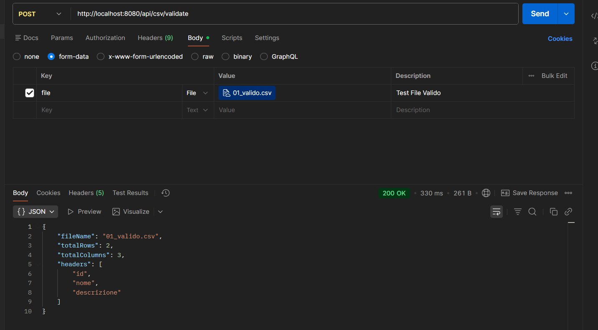
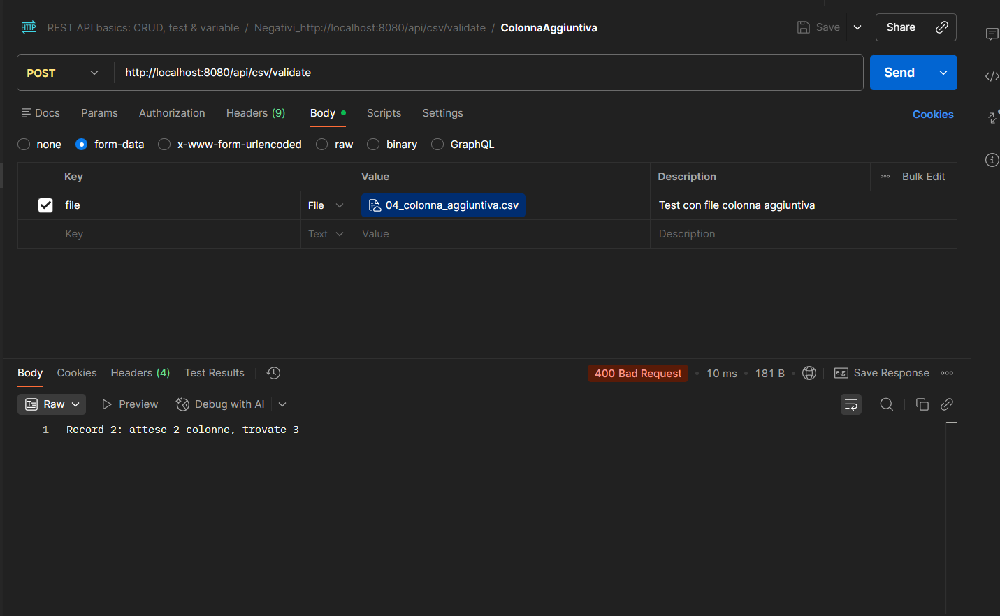

# CSV Manager

Applicazione dimostrativa sviluppata con **Java 21 e Spring Boot** per validare file CSV e, nelle successive versioni, estrarre dati da database, unire file e generare esportazioni.

## Stato del progetto

**Struttura base con il primo endpoint di validazione CSV implementato.**

| Funzionalità | Stato |
| --- | --- |
| Validazione CSV e riepilogo JSON | Implementata |
| Interfaccia web per caricare i file | Pianificata |
| Configurazione delle connessioni ai database | Pianificata |
| Estrazione dati da database e generazione CSV | Pianificata |
| Merge di CSV tramite una chiave comune | Pianificata |
| Esportazione dei risultati in Excel | Pianificata |
| Autenticazione e gestione dei ruoli | Pianificata |

## Endpoint implementato

### POST /api/csv/validate

Riceve **un singolo file CSV** tramite `multipart/form-data`, nel campo **file**.

Controlla:

- File non vuoto ed estensione `.csv`.
- Intestazione con nomi non vuoti e non duplicati dopo la rimozione degli spazi esterni.
- Numero di campi di ogni record coerente con l’intestazione.
- Assenza di valori vuoti o composti soltanto da spazi.
- Corretta lettura dei campi tra virgolette, comprese virgole e contenuti multilinea.

Il file viene letto in UTF-8 con separatore virgola. I nomi delle colonne distinguono maiuscole e minuscole. È accettato anche un CSV con sola intestazione.

**Risposta valida — HTTP 200:**

```json
{
  "fileName": "valido.csv",
  "totalRows": 2,
  "totalColumns": 2,
  "headers": ["id", "nome"]
}
```

`totalRows` conta i record di dati, escludendo l’intestazione.

**Errore di validazione — HTTP 400:** restituisce un messaggio testuale e interrompe il controllo al primo errore. Esempio:

```text
Record 2: attese 2 colonne, trovate 3
```

La numerazione degli errori comprende l’intestazione come record 1. Non vengono ancora verificati i tipi dei valori, come date o numeri.

## Struttura

```text
src/
├── main/
│   ├── java/com/gianluca/csvmanager/
│   │   ├── CsvManagerApplication.java
│   │   ├── controller/
│   │   │   └── CsvValidationController.java
│   │   ├── service/
│   │   │   └── CsvValidationService.java
│   │   ├── dto/
│   │   │   └── CsvValidationResponse.java
│   │   └── exception/
│   │       └── InvalidCsvException.java
│   └── resources/
│       └── application.yml
└── test/
    ├── java/com/gianluca/csvmanager/
    │   ├── integration/
    │   │   └── CsvValidationControllerTest.java
    │   └── unit/
    │       └── package-info.java
    └── resources/csv/
        └── valido.csv
```

- **controller** — richieste e risposte HTTP.
- **service** — validazione dell’intestazione e dei record.
- **dto** — riepilogo restituito in JSON.
- **exception** — errori di validazione.
- **integration** — test con MockMvc e service reale.
- **unit** — package predisposto per i futuri test unitari.

Il package radice è `com.gianluca.csvmanager`. I file `package-info.java` documentano le responsabilità dei package; nell’albero è mostrato quello di `unit`, che non contiene ancora test.

Il parsing utilizza **Apache Commons CSV**.

## Avvio e test

Richiede Java 21. Non è necessario un database per la funzionalità attuale.

```powershell
.\mvnw.cmd spring-boot:run
```

L’applicazione ascolta su `http://localhost:8080`, con accesso locale.

Per eseguire i **17 test automatici**:

```powershell
.\mvnw.cmd test
```

## Verifica con Postman

Inviare una richiesta **POST** a:

```text
http://localhost:8080/api/csv/validate
```

In **Body → form-data**, impostare la Key `file`, scegliere il tipo **File** e selezionare un solo CSV. Postman imposta automaticamente il Content-Type.

### Caso positivo — CSV valido

Caricamento di `01_valido.csv`: l’API restituisce **200 OK**, con **2 record di dati e 3 colonne** (`id`, `nome`, `descrizione`).



### Caso negativo — Colonna aggiuntiva

Caricamento di `04_colonna_aggiuntiva.csv`: il primo record di dati contiene **3 campi**, mentre l’intestazione ne definisce **2**. L’API restituisce **400 Bad Request** con il messaggio:

```text
Record 2: attese 2 colonne, trovate 3
```


